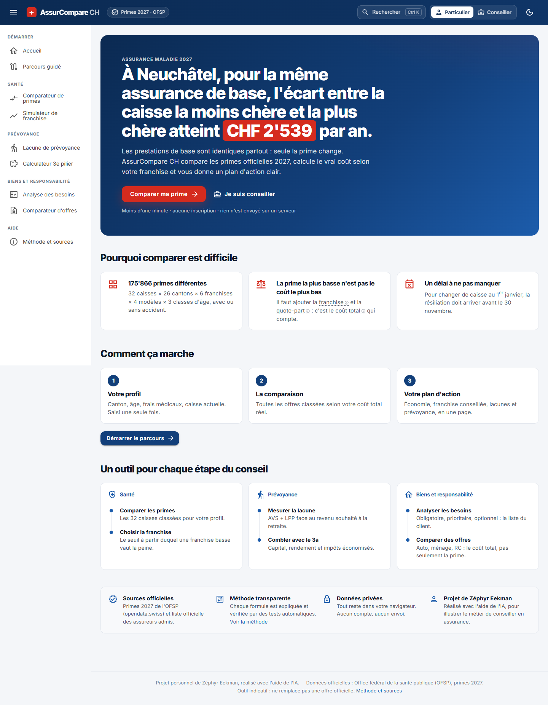
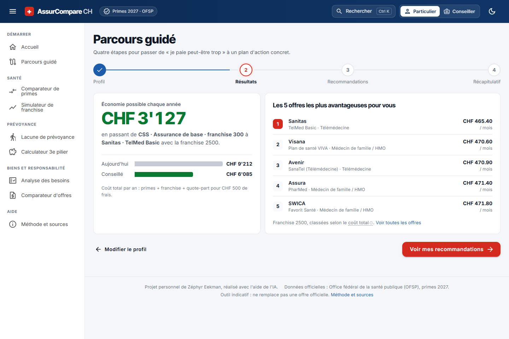
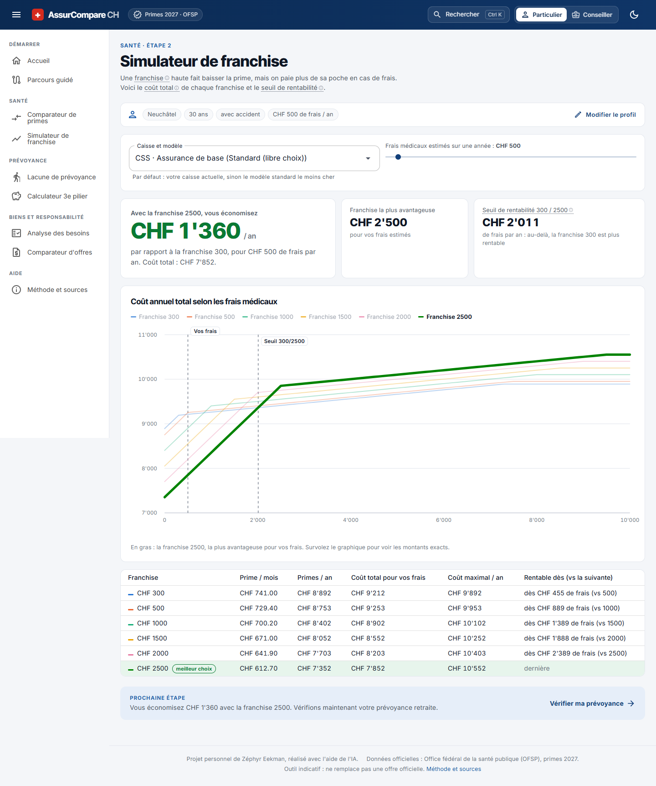
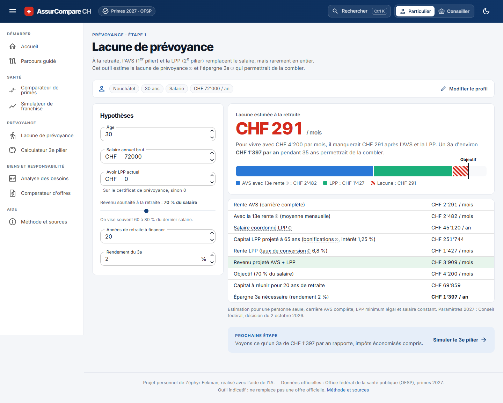
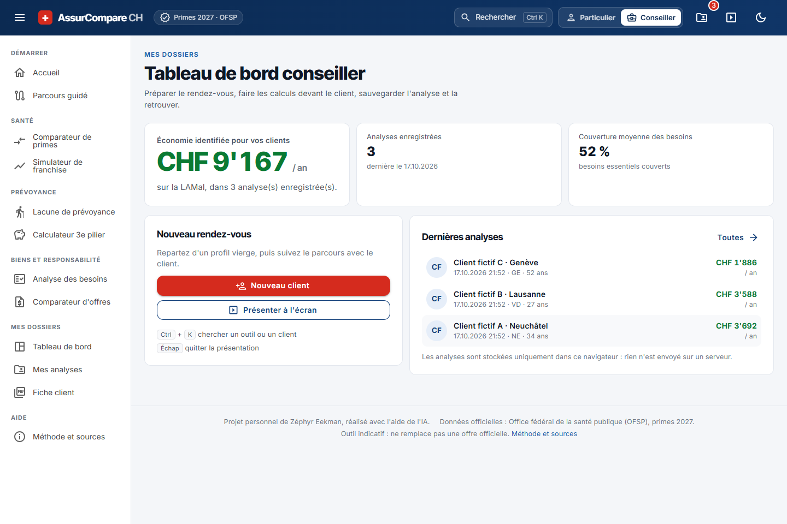
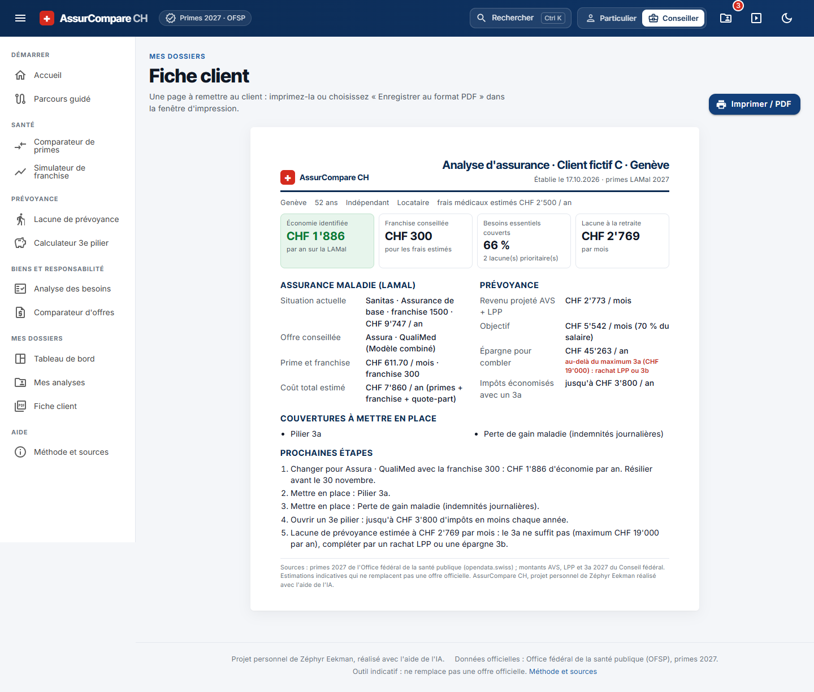
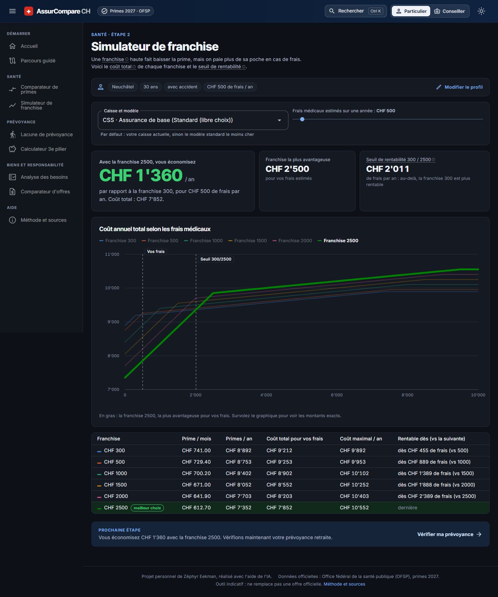
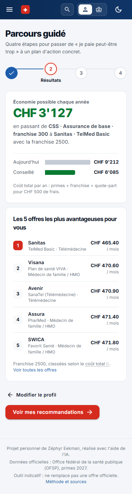

# AssurCompare CH

**Comparer sa prime, choisir sa franchise, mesurer sa prévoyance, et repartir avec un plan d'action.**
Une application d'aide au conseil en assurance pour la Suisse, construite sur les primes LAMal **2027** officielles de l'OFSP.

L'application tourne entièrement dans le navigateur (Blazor WebAssembly, .NET 10), sans serveur ni compte :
le profil et les analyses restent sur l'appareil.

> Projet personnel de **Zéphyr Eekman**, réalisé avec l'aide de l'IA, pour illustrer ma motivation
> pour le conseil en assurance. Outil indicatif : il ne remplace ni une offre officielle ni [priminfo.admin.ch](https://www.priminfo.admin.ch).



## Deux publics, deux parcours

| | Particulier | Conseiller |
|---|---|---|
| **But** | Comprendre pourquoi comparer est difficile et faire une première comparaison en moins d'une minute | Préparer un rendez-vous, calculer devant le client, sauvegarder et exporter |
| **Entrée** | Bouton « Comparer ma prime » → parcours guidé | Sélecteur « Conseiller » dans l'en-tête → tableau de bord |
| **Débloque** | | Dossier client, analyses sauvegardées, fiche PDF, mode présentation, Ctrl+K |

## Parcours utilisateur

Le profil (canton, âge, frais médicaux, caisse actuelle, situation, salaire) est **saisi une seule fois** et partagé par tous les outils.

1. **Profil** : un formulaire, avec une explication au survol de chaque terme technique (franchise, quote-part, modèle alternatif…).
2. **Résultats** : l'économie possible en très grand, la comparaison « aujourd'hui / conseillé » et les 5 meilleures offres.
3. **Recommandations** : franchise conseillée, couverture des besoins, lacune de retraite et plan d'action chiffré.
4. **Récapitulatif** : sauvegarde (mode conseiller) et fiche client d'une page.



Chaque outil se termine par une **prochaine étape suggérée** : comparateur → franchise → prévoyance → 3e pilier → besoins → offres → fiche.

| Outil | Ce qu'il calcule |
|---|---|
| **Comparateur de primes LAMal** | Les 32 caisses du canton classées selon le coût total réel, et l'économie par rapport à la caisse actuelle. |
| **Simulateur de franchise** | Le coût réel de chaque franchise et le **seuil de rentabilité**. La courbe gagnante est mise en avant. |
| **Lacune de prévoyance** *(nouveau)* | AVS 2027 (avec 13e rente) + LPP (salaire coordonné, bonifications, conversion) face au revenu souhaité, et le 3a nécessaire pour combler l'écart. |
| **Calculateur 3e pilier** | Capital à 65 ans, rendement composé et impôts économisés, avec les maximums 2026 et 2027. |
| **Analyse des besoins** | Couvertures obligatoires, prioritaires et optionnelles selon la situation du client. |
| **Comparateur d'offres** | Auto, ménage, RC : le coût total sur plusieurs années, pas seulement la prime. |




## Mode conseiller

- **Tableau de bord** : nombre d'analyses, économie totale identifiée pour les clients, dernières analyses, et 3 clients fictifs pour une démo.
- **Mes analyses** : recherche, tri, reprise, duplication et suppression avec confirmation dans la page.
- **Fiche client PDF** : une page A4 avec profil, comparaison LAMal, franchise conseillée, lacunes, prévoyance, prochaines étapes et sources.
- **Mode présentation** : menus masqués et chiffres agrandis pour montrer l'écran au client (Échap pour quitter).
- **Ctrl+K** : chercher un outil ou un client.
- **Confidentialité** : stockage local du navigateur (localStorage) uniquement, avec un message clair si le navigateur le bloque.




<p>
  
  
</p>

## Données et paramètres

- **Primes 2027** : jeu de données officiel de l'OFSP,
  [Primes de l'assurance-maladie sur opendata.swiss](https://opendata.swiss/fr/dataset/health-insurance-premiums).
  Le fichier contient 175'866 primes pour 26 cantons et 32 caisses.
- **Noms des caisses** : liste officielle des assureurs-maladie admis (OFSP, état au 1.1.2026).
- **AVS, LPP, 3a** : tous les montants annuels sont réunis dans [`SwissParameters.cs`](src/AssurCompare.Core/Parametres/SwissParameters.cs)
  (2026 et 2027, d'après la décision du Conseil fédéral du 2 octobre 2026). Pour passer à une nouvelle année, il suffit d'ajouter une entrée dans ce fichier.

Le programme `tools/AssurCompare.DataPrep` convertit le fichier brut (24 Mo) en un fichier JSON par canton (90 à 300 Ko),
téléchargé seulement quand on choisit ce canton.

## Architecture

```
src/
  AssurCompare.Core/      Règles et calculs (C# pur, sans interface)
    Lamal/                Participation aux coûts, franchises, comparaison des primes
    Prevoyance/           Pilier 3a et lacune de prévoyance (AVS, LPP)
    Parametres/           Montants légaux par année
    Analyses/             Résumé d'analyse client (réutilise tous les calculateurs)
    Offres/, Besoins/     Coût total d'une offre, analyse des besoins
  AssurCompare.Web/       Blazor WebAssembly + MudBlazor
    Services/             État partagé (profil, mode, analyses), stockage navigateur
    Components/           Graphique SVG maison, chiffres héros animés, lexique, palette Ctrl+K
tests/
  AssurCompare.Core.Tests/  73 tests automatiques (xUnit)
tools/
  AssurCompare.DataPrep/    Préparation des données OFSP
```

Les calculs sont séparés de l'interface et chaque formule importante est vérifiée par un test, souvent avec un exemple calculé à la main.
L'interface respecte `prefers-reduced-motion`, fonctionne au clavier, en clair et en sombre, et sur mobile sans défilement horizontal.

## Lancer le projet

Prérequis : [SDK .NET 10](https://dotnet.microsoft.com/download).

```bash
dotnet test                                   # lance les tests
dotnet run --project src/AssurCompare.Web     # puis ouvrir l'adresse affichée
```

Pour régénérer les données, téléchargez `Prämien_CH.csv` et `Tarife.csv` depuis opendata.swiss dans `data-source/ofsp/`,
renommez-les `Primes_CH.csv` et `Tarifs.csv`, puis lancez :

```bash
dotnet run --project tools/AssurCompare.DataPrep -- data-source/ofsp src/AssurCompare.Web/wwwroot/data
```

## Publication

À chaque envoi sur la branche `main`, GitHub Actions lance les tests, publie l'application et la met en ligne sur GitHub Pages
(`.github/workflows/deploy.yml`).

## Limites connues

- La contribution aux frais hospitaliers (CHF 15 par jour) n'est pas modélisée.
- Les rabais pour le 2e ou 3e enfant ne sont pas repris.
- Pour les cantons à plusieurs régions de primes, l'utilisateur choisit la région lui-même : la recherche par NPA n'est pas disponible, faute de table officielle NPA → région dans les données utilisées.
- Prévoyance : personne seule, carrière AVS complète, LPP minimum légal, salaire constant. 3e pilier : rendement constant, impôt au retrait non modélisé.
